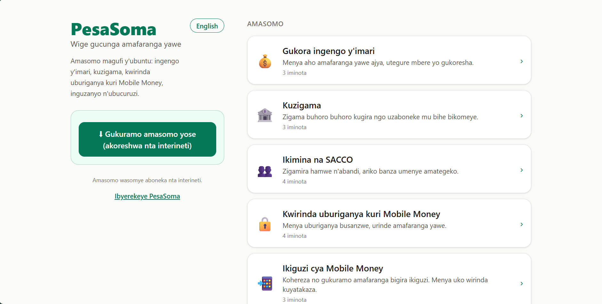
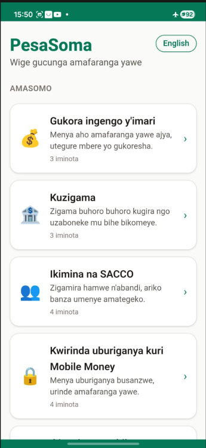

# PesaSoma

Offline-first financial-literacy app for Rwanda. Lessons in **Kinyarwanda** and **English**,
short quizzes, a daily streak, and no account needed. Built as a PWA so it installs from the
browser and keeps working without internet.

**Live app:** https://pesasoma.vercel.app

**Stack:** Next.js (App Router, TypeScript) · Tailwind CSS v4 · hand-written service worker.

## Screenshots

| Desktop | Mobile |
|---|---|
|  |  |

## Run it

Requires **Node.js 20.9 or newer** (`node -v`).

```bash
npm install
npm run dev          # http://localhost:3000
```

The offline service worker only runs in a production build. To test offline mode:

```bash
npm run build
npm start            # http://localhost:3000
```

Open it in Chrome, visit a lesson, then in DevTools > Network tick "Offline" and reload.
The visited pages still load. On Android, Chrome's menu shows "Install app".

## Project map

| Path | What it does |
|---|---|
| `lib/lessons.ts` | **All lesson content** (Kinyarwanda + English). Add a lesson = add an object. |
| `lib/i18n.ts` | Interface text (buttons, labels) in both languages. |
| `lib/progress.ts` | Saves quiz scores and streak on the phone (localStorage). |
| `app/page.tsx` | Language chooser (first screen). |
| `app/[lang]/page.tsx` | Lesson list. |
| `app/[lang]/lessons/[id]/page.tsx` | One lesson: steps, example, quiz. |
| `components/Quiz.tsx` | Multiple-choice quiz. |
| `public/sw.js` | Service worker: caches pages so they work offline. |
| `app/manifest.ts` | PWA install info (name, icons, colours). |
| `public/audio/` | Put MP3 narration here (see its README). |

## Deploy (free)

1. Push this folder to GitHub.
2. Go to vercel.com, **Add New > Project**, pick the repo, click **Deploy**.
3. You get a public link. Add a custom domain later.

## Notes

- The Kinyarwanda text was reviewed by fluent speakers. Spotted a mistake? Open an issue.
- Changed the cached files list in `public/sw.js`? Bump `CACHE_VERSION` so phones refresh.

## License

MIT. See the `LICENSE` file.
